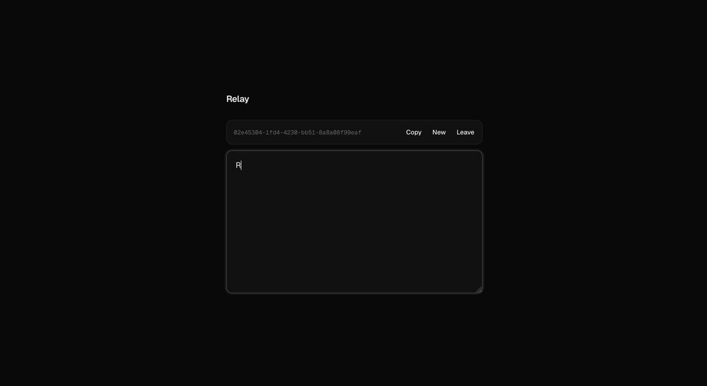

# Weavo

<p align="center">
  
</p>

> Tiny, framework-agnostic real-time collaborative text editing.

<p align="center">
  
</p>
<p align="center"><sub>Mobile · Desktop — same room, live sync</sub></p>

---

Weavo turns a native `<textarea>` or Monaco Editor into a collaborative surface.

No CRDT knowledge. No editor framework. No React dependency. Bind an editor, connect to a room, and every participant stays in sync.

**Demo:** https://soham0w0sarkar.github.io/Weavo/

---

## Features

- Bind a native `HTMLTextAreaElement` or Monaco Editor
- Automatic real-time synchronization
- Conflict-free concurrent editing
- Cursor/selection preservation during remote edits
- Tiny, dependency-light client
- Works with any compatible Weavo WebSocket server
- Framework agnostic (React, Vue, Svelte, Solid, Vanilla JS...)

---

## Installation

Textarea:

```bash
npm install @weavo/client @weavo/textarea-adapter
```

Monaco:

```bash
npm install @weavo/client @weavo/monaco-adapter monaco-editor
```

Same packages work with `pnpm` or `bun`.

---

## Quick Start

Weavo needs a **WebSocket relay** and the **browser client**. The server just forwards frames — clients handle merging.

### 1. WebSocket server

```bash
npm install ws
```

```js
// server.js — node server.js
const { WebSocketServer } = require("ws");

const wss = new WebSocketServer({ port: 8080 });

wss.on("connection", (ws) => {
  ws.on("message", (data) => {
    for (const client of wss.clients) {
      if (client !== ws && client.readyState === 1) client.send(data);
    }
  });
});

console.log("ws://localhost:8080");
```

### 2. Browser client — textarea

```ts
import { createWeavo } from "@weavo/client";
import { textareaAdapter } from "@weavo/textarea-adapter";

const weavo = createWeavo("ws://localhost:8080", {
  adapter: textareaAdapter,
});

const textarea = document.querySelector("textarea")!;
const dispose = weavo.bind(textarea);
```

### 3. Browser client — Monaco

```ts
import { createWeavo } from "@weavo/client";
import { monacoAdapter } from "@weavo/monaco-adapter";
import * as monaco from "monaco-editor";

const editor = monaco.editor.create(container, { language: "typescript" });
const weavo = createWeavo("ws://localhost:8080?room=code", {
  adapter: monacoAdapter,
});
const dispose = weavo.bind(editor);
```

That's it — open two tabs and start typing. Use `wss://` in production.

---

## API

### `createWeavo(urlOrTransport, options?)`

Creates a Weavo document.

```ts
const weavo = createWeavo("wss://localhost:8080?room=notes");
```

You may also pass a custom transport instead of a URL, plus optional persistence hooks:

```ts
const weavo = createWeavo(url, {
  initial: { snapshot, delta }, // restore from storage
  onOp(op) {
    /* append to delta log */
  },
});
```

---

### `weavo.bind(target)`

Binds a native textarea or Monaco editor to the collaborative document (via the adapter you passed to `createWeavo`).

```ts
const cleanup = weavo.bind(textarea);
// or: weavo.bind(monacoEditor)
```

Returns a cleanup function.

```ts
cleanup();
```

---

### `weavo.textSubscribe(listener)`

Listen for document text changes.

```ts
const unsubscribe = weavo.textSubscribe((change) => {
  console.log(change); // { index: 3, insert: "a" } or { index: 1, delete: 2 }
});
```

Useful for analytics, live previews, and custom UI updates.

---

### `weavo.snapshot()` — persistence

Capture a JSON checkpoint of the document (CRDT state + state vector):

```ts
const checkpoint = weavo.snapshot();
localStorage.setItem("doc:snapshot", JSON.stringify(checkpoint));
localStorage.setItem("doc:delta", "[]");
```

Restore on the next visit with **base + delta**:

1. Save `weavo.snapshot()` as the base checkpoint.
2. Append every operation via `onOp` to a delta array.
3. Pass `initial: { snapshot, delta }` to `createWeavo`.

`DocumentSnapshot` is plain JSON — use any database or file store. See [`packages/client/README.md`](./packages/client/README.md) for a full localStorage example.

## How it Works

Weavo observes editor input, converts it into editing operations, synchronizes those operations over WebSockets, and automatically applies incoming changes while preserving the user's current cursor and selection whenever possible.

From the application's perspective, it's simply:

```
User Input
      ↓
Weavo
      ↓
WebSocket
      ↓
Everyone Else
```

No manual diffing.

No reconciliation logic.

No polling.

---

## Framework Example

### React

```tsx
const weavo = createWeavo(url, { adapter: textareaAdapter });

useEffect(() => {
  if (!ref.current) return;
  return weavo.bind(ref.current);
}, []);
```

Because Weavo works directly with the editor host, it can be used with virtually any frontend framework.

---

## Browser Support

Modern browsers supporting:

- WebSocket
- beforeinput events (textarea adapter)
- HTMLTextAreaElement and/or Monaco Editor
- ES Modules

---

## Philosophy

Weavo intentionally focuses on one thing:

> Make collaborative plain-text editing ridiculously simple.

It does **not** attempt to become:

- a rich text editor
- an editor framework
- a UI toolkit

Instead, Weavo provides a reliable synchronization layer plus thin adapters for textarea and Monaco that can be integrated anywhere.

---

## Packages

This repository is a monorepo containing:

| Package                   | Description                  |
| ------------------------- | ---------------------------- |
| `@weavo/client`           | Browser document + sync      |
| `@weavo/textarea-adapter` | Native textarea binding      |
| `@weavo/monaco-adapter`   | Monaco Editor binding        |
| `@weavo/membership`       | Room membership + presence   |
| `@weavo/core`             | Collaborative editing engine |
| `@weavo/sync`             | Synchronization protocol     |
| `@weavo/transport`        | Transport abstraction        |

Design notes: [`ARCHITECTURE.md`](./ARCHITECTURE.md)

---

## Development

```bash
bun install

bun run dev
```

That starts `weavo-server` and the demo together. For docs only: `bun run dev:docs`. For every workspace: `bun run dev:all`.

Build all packages:

```bash
bun run build
```

---

## License

MIT
